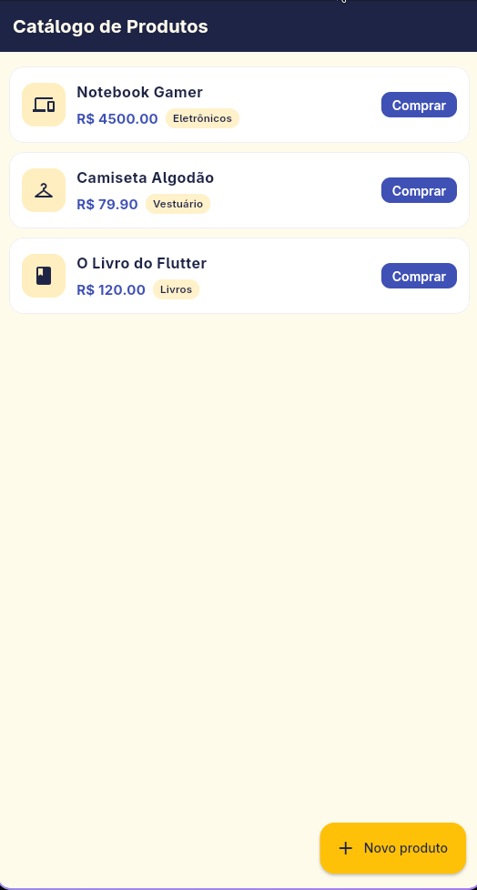
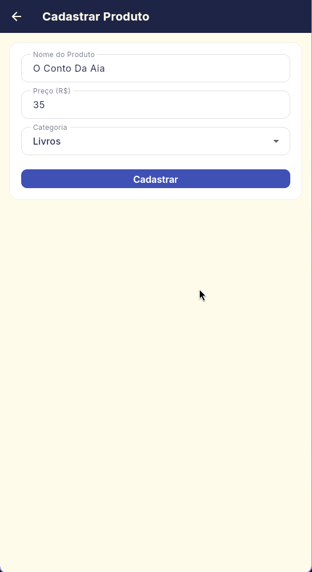
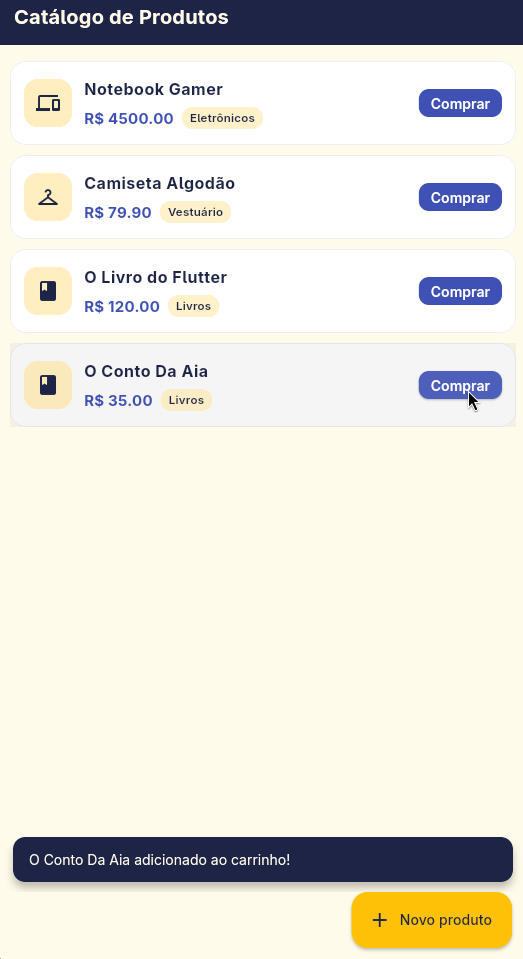

# Catálogo de Produtos

Aplicativo Flutter desenvolvido para a atividade **Catálogo de Produtos**. Permite visualizar uma lista de produtos, cadastrar novos itens e atualizar o catálogo dinamicamente, além de simular a adição de produtos ao carrinho.

## Imagens do aplicativo

<p align="center">
  
  
  
</p>

## Funcionalidades

- **Catálogo** com os produtos exibidos em `Card` dentro de um `ListView.builder`.
- Cada card mostra:
  - ícone definido pela categoria do produto;
  - nome;
  - preço formatado em reais (`R$`);
  - botão **Comprar**.
- **FloatingActionButton "Novo produto"** que abre a tela de cadastro.
- **Tela Cadastrar Produto** com validação de:
  - nome do produto;
  - preço (aceita `19.90` e `19,90`);
  - categoria escolhida em um `DropdownButtonFormField` (baseado em `DropdownButton`).
- Ao confirmar, o app volta para o catálogo e **adiciona** o novo produto ao final da lista, preservando os que já existiam.
- Ao tocar em um produto (ou no botão **Comprar**), é exibido um `SnackBar` informando que o item foi adicionado ao carrinho.
- Estado vazio com mensagem quando não há produtos cadastrados.

## Categorias e ícones

| Categoria    | Ícone                          |
| ------------ | ------------------------------ |
| Eletrônicos  | `Icons.devices`                |
| Vestuário    | `Icons.checkroom`              |
| Alimentação  | `Icons.restaurant`             |
| Livros       | `Icons.book`                   |
| Outras       | `Icons.shopping_bag` (padrão)  |

O mapeamento fica em `Product.icon` (`lib/models/product.dart`), garantindo que o ícone do catálogo seja sempre definido pela categoria escolhida no cadastro.

## Estrutura do projeto

```text
lib/
├── main.dart                                  # MaterialApp e tema
├── models/
│   └── product.dart                           # Modelo Product + ícone por categoria
├── screens/
│   ├── add_product/
│   │   └── add_product_screen.dart            # Formulário de cadastro
│   └── product_list/
│       └── product_list_screen.dart           # Lista, FAB, SnackBar
└── theme/
    └── app_theme.dart                         # Cores e tema Material 3
test/
└── widget_test.dart                           # Testes de widget
```

## Requisitos da atividade

| Requisito                                                        | Onde está implementado                              |
| ---------------------------------------------------------------- | --------------------------------------------------- |
| Lista com `List` e `ListView.builder`                            | `_products` e `ListView.builder` em `product_list_screen.dart` |
| Produto com nome, preço e categoria                              | `lib/models/product.dart`                           |
| Card com ícone da categoria, nome, preço e botão Comprar         | `ListTile` dentro de `Card` em `product_list_screen.dart` |
| `FloatingActionButton` para cadastrar novo produto               | `FloatingActionButton.extended` em `product_list_screen.dart` |
| Navegação para a tela Cadastrar Produto                          | `Navigator.push` em `_openAddProductScreen`         |
| Cadastro com nome, preço e categoria via `DropdownButton`        | `add_product_screen.dart`                           |
| Retornar e adicionar o produto sem substituir os existentes      | `Navigator.pop(context, newProduct)` + `_products.add(...)` |
| Ícone definido pela categoria                                    | Getter `Product.icon`                               |
| SnackBar ao clicar no produto informando adição ao carrinho      | `ListTile.onTap` e botão Comprar chamam `_addToCart` |
